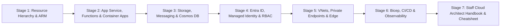
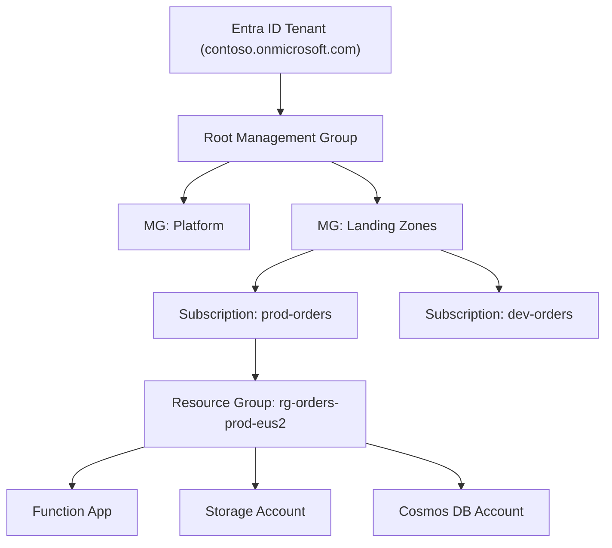
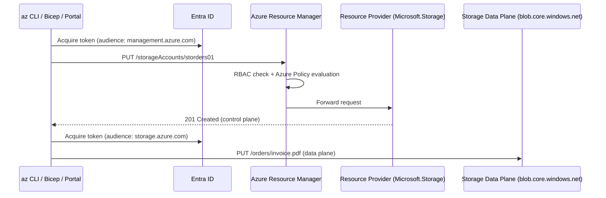
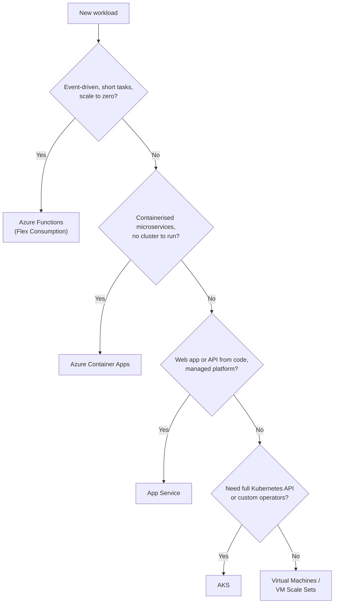
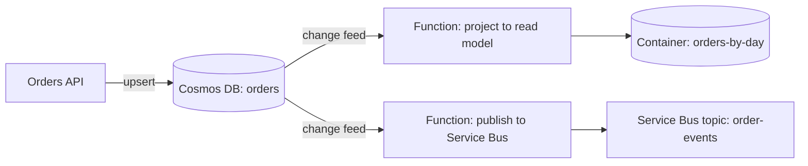
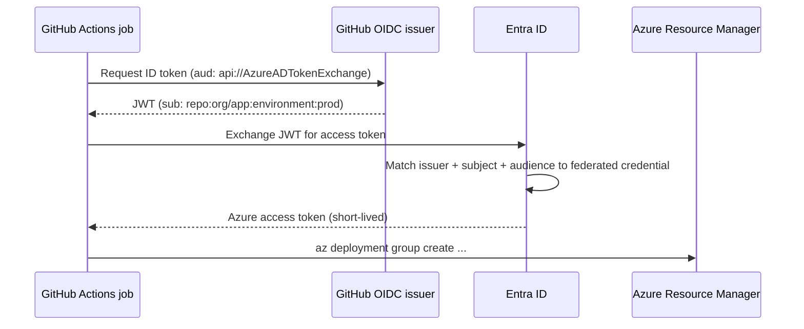
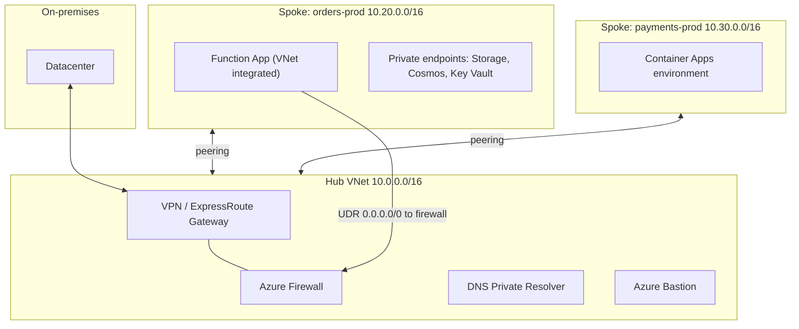
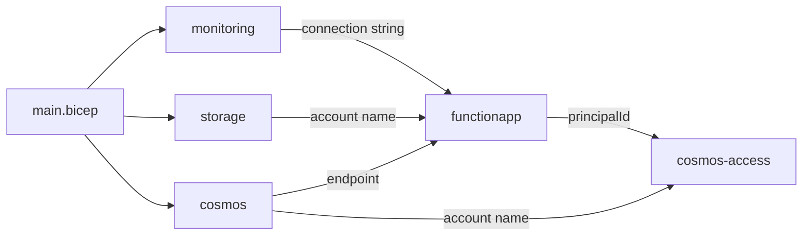

# Learn Microsoft Azure ☁️

<div align="center">

[](https://opensource.org/licenses/MIT)
[](https://azure.microsoft.com/)
[](https://learn.microsoft.com/azure/azure-functions/)
[](https://learn.microsoft.com/azure/azure-resource-manager/bicep/)
[](https://nodejs.org/)
[](https://github.com/TheLearningHubOrg/learn-azure)

**An exhaustive, production-grade masterclass from absolute zero to staff-level Microsoft Azure cloud architecture.**  
Master the resource hierarchy, App Service and Azure Functions, Storage and Cosmos DB, identity with Entra ID, private networking, and repeatable Bicep infrastructure as code.

[Getting Started](#1-stage-1-absolute-beginner-foundations--resource-hierarchy) • [Compute](#2-stage-2-compute-deep-dive-app-service-functions--container-apps) • [Storage & Data](#3-stage-3-storage-messaging--cosmos-db) • [Identity](#4-stage-4-identity--access-with-entra-id) • [Networking](#5-stage-5-networking-private-endpoints--zero-trust) • [Bicep & Operations](#6-stage-6-bicep-infrastructure-as-code--production-operations) • [Staff Handbook](#7-stage-7-staff-cloud-architect-interview-handbook--cheatsheet)

<br/>

<a href="https://www.buymeacoffee.com/manthanank">
  
</a>

</div>

---

## 🗺️ 7-Stage Pedagogical Roadmap



| Stage | Domain Focus | Core Concepts & Production Outcomes |
| :--- | :--- | :--- |
| **Stage 1** | **Foundations & Resource Hierarchy** | Tenants, management groups, subscriptions, resource groups, regions and availability zones, the Azure Resource Manager control plane, `az` CLI fundamentals, pricing models. |
| **Stage 2** | **Compute: App Service, Functions & Container Apps** | Choosing a compute model, App Service plans and deployment slots, Functions triggers and bindings, Flex Consumption, Durable Functions, Container Apps with KEDA scaling. |
| **Stage 3** | **Storage, Messaging & Cosmos DB** | Redundancy (`LRS`/`ZRS`/`GRS`/`GZRS`), blob tiers and lifecycle rules, Queue Storage vs Service Bus vs Event Grid, Cosmos DB partitioning, Request Units, consistency levels, change feed. |
| **Stage 4** | **Identity & Access with Entra ID** | App registrations vs service principals, managed identities, Azure RBAC scopes, `DefaultAzureCredential`, Key Vault references, OIDC workload identity federation for CI. |
| **Stage 5** | **Networking & Zero Trust** | VNets, subnets and NSGs, private endpoints and Private DNS, VNet integration, hub-spoke topologies, Front Door vs Application Gateway vs Load Balancer, NAT Gateway egress. |
| **Stage 6** | **Bicep IaC & Production Operations** | Bicep modules and `.bicepparam` files, `what-if`, deployment stacks, GitHub Actions with OIDC, Application Insights and KQL, Azure Policy, budgets and cost governance. |
| **Stage 7** | **Staff Cloud Architect Interview Handbook** | 40 staff-level scenario Q&As covering failure modes, multi-region design, identity, networking and cost, plus an enterprise `az` and Bicep cheatsheet. |

---

## 📋 Table of Contents
- [1. Stage 1: Absolute Beginner Foundations & Resource Hierarchy](#1-stage-1-absolute-beginner-foundations--resource-hierarchy)
  - [1.1 What Azure Is & How It Is Organised](#11-what-azure-is--how-it-is-organised)
  - [1.2 Regions, Availability Zones & Region Pairs](#12-regions-availability-zones--region-pairs)
  - [1.3 Azure Resource Manager: Control Plane vs Data Plane](#13-azure-resource-manager-control-plane-vs-data-plane)
  - [1.4 Installing the az CLI & Creating Your First Resources](#14-installing-the-az-cli--creating-your-first-resources)
  - [1.5 Pricing Models & The Cost Mindset](#15-pricing-models--the-cost-mindset)
- [2. Stage 2: Compute Deep Dive: App Service, Functions & Container Apps](#2-stage-2-compute-deep-dive-app-service-functions--container-apps)
  - [2.1 Choosing a Compute Model](#21-choosing-a-compute-model)
  - [2.2 App Service: Plans, Slots & Configuration](#22-app-service-plans-slots--configuration)
  - [2.3 Azure Functions: Triggers, Bindings & Hosting Plans](#23-azure-functions-triggers-bindings--hosting-plans)
  - [2.4 Writing a Function in TypeScript (Node.js v4 Programming Model)](#24-writing-a-function-in-typescript-nodejs-v4-programming-model)
  - [2.5 Durable Functions: Stateful Orchestration](#25-durable-functions-stateful-orchestration)
  - [2.6 Azure Container Apps](#26-azure-container-apps)
- [3. Stage 3: Storage, Messaging & Cosmos DB](#3-stage-3-storage-messaging--cosmos-db)
  - [3.1 Storage Accounts & Redundancy](#31-storage-accounts--redundancy)
  - [3.2 Blob Access Tiers & Lifecycle Management](#32-blob-access-tiers--lifecycle-management)
  - [3.3 Queue Storage vs Service Bus vs Event Grid vs Event Hubs](#33-queue-storage-vs-service-bus-vs-event-grid-vs-event-hubs)
  - [3.4 Cosmos DB: Partitioning & Request Units](#34-cosmos-db-partitioning--request-units)
  - [3.5 Consistency Levels](#35-consistency-levels)
  - [3.6 Change Feed](#36-change-feed)
- [4. Stage 4: Identity & Access with Entra ID](#4-stage-4-identity--access-with-entra-id)
  - [4.1 Entra ID Building Blocks](#41-entra-id-building-blocks)
  - [4.2 Managed Identities: System-Assigned vs User-Assigned](#42-managed-identities-system-assigned-vs-user-assigned)
  - [4.3 Azure RBAC: Roles, Scopes & Assignments](#43-azure-rbac-roles-scopes--assignments)
  - [4.4 Passwordless Code with DefaultAzureCredential](#44-passwordless-code-with-defaultazurecredential)
  - [4.5 Key Vault & App Settings References](#45-key-vault--app-settings-references)
  - [4.6 Workload Identity Federation for CI/CD (No Secrets in GitHub)](#46-workload-identity-federation-for-cicd-no-secrets-in-github)
- [5. Stage 5: Networking, Private Endpoints & Zero Trust](#5-stage-5-networking-private-endpoints--zero-trust)
  - [5.1 Virtual Networks, Subnets & NSGs](#51-virtual-networks-subnets--nsgs)
  - [5.2 Private Endpoints vs Service Endpoints](#52-private-endpoints-vs-service-endpoints)
  - [5.3 Private DNS: The Part Everyone Gets Wrong](#53-private-dns-the-part-everyone-gets-wrong)
  - [5.4 Load Balancing & The Edge](#54-load-balancing--the-edge)
  - [5.5 Hub-Spoke Topology & Controlled Egress](#55-hub-spoke-topology--controlled-egress)
- [6. Stage 6: Bicep Infrastructure as Code & Production Operations](#6-stage-6-bicep-infrastructure-as-code--production-operations)
  - [6.1 Bicep Fundamentals](#61-bicep-fundamentals)
  - [6.2 Modules, Parameter Files & This Repository's Layout](#62-modules-parameter-files--this-repositorys-layout)
  - [6.3 Deploying Safely: what-if, Deployment Stacks & Scripts](#63-deploying-safely-what-if-deployment-stacks--scripts)
  - [6.4 CI/CD with GitHub Actions & OIDC](#64-cicd-with-github-actions--oidc)
  - [6.5 Observability: Application Insights & KQL](#65-observability-application-insights--kql)
  - [6.6 Governance: Azure Policy, Tags & Budgets](#66-governance-azure-policy-tags--budgets)
  - [6.7 Running the Companion Project](#67-running-the-companion-project)
- [7. Stage 7: Staff Cloud Architect Interview Handbook & Cheatsheet](#7-stage-7-staff-cloud-architect-interview-handbook--cheatsheet)
  - [7.1 Enterprise Production Cheatsheet](#71-enterprise-production-cheatsheet)
  - [7.2 Staff & Principal Architect Interview Q&A (40 Scenarios)](#72-staff--principal-architect-interview-qa-40-scenarios)
- [🤝 Contributing](#-contributing)
- [📄 License](#-license)

---

## 1. Stage 1: Absolute Beginner Foundations & Resource Hierarchy

### 1.1 What Azure Is & How It Is Organised

Microsoft Azure is a public cloud: a global fleet of datacenters that rents out compute, storage, networking, databases, identity and hundreds of managed services through one API. Every resource you create, from a virtual machine to a single storage queue, is an entry in a strict hierarchy. That hierarchy decides who can touch the resource, who pays for it, and which policies apply to it. Understanding it is the first real skill in Azure.



1. **Tenant:** a dedicated Microsoft Entra ID directory. It holds users, groups and application identities. A tenant is the security boundary for identity.
2. **Management groups:** folders above subscriptions. Policies and role assignments applied here flow down to every subscription beneath. Up to six levels of depth are allowed below the root.
3. **Subscription:** the billing and quota boundary. Each subscription trusts exactly one tenant. Large organisations use many subscriptions (per workload and environment) to isolate blast radius and quota.
4. **Resource group:** a logical container for resources that share a lifecycle. Deleting a resource group deletes everything in it. A resource group has a region, but that region only stores its metadata. Its resources can live in any region.
5. **Resource:** a single manageable item with an ID such as `/subscriptions/<id>/resourceGroups/rg-orders/providers/Microsoft.Storage/storageAccounts/storders01`.

### 1.2 Regions, Availability Zones & Region Pairs

Azure runs in more than 60 regions. A region is a set of datacenters within a latency-defined perimeter. Many regions offer **availability zones**: physically separate datacenter groups, each with independent power, cooling and networking, connected by high-speed links.

```
 Region: East US 2
 ┌──────────────────────────────────────────────────────────┐
 │  Zone 1              Zone 2              Zone 3          │
 │  ┌──────────┐        ┌──────────┐        ┌──────────┐    │
 │  │ App inst │        │ App inst │        │ App inst │    │
 │  │ ZRS copy │◄──────►│ ZRS copy │◄──────►│ ZRS copy │    │
 │  └──────────┘        └──────────┘        └──────────┘    │
 └──────────────────────────────────────────────────────────┘
          │  asynchronous geo-replication (GRS / GZRS)
          ▼
 Paired region: Central US (read-only secondary until failover)
```

1. **Zonal resources** are pinned to one zone you choose (a VM in zone 2).
2. **Zone-redundant resources** spread themselves across zones automatically (ZRS storage, zone-redundant App Service plans, zone-redundant Cosmos DB regions).
3. **Region pairs** are a fixed Microsoft pairing used by geo-redundant storage and for staggered platform updates. Several newer regions have no pair, so multi-region designs increasingly choose their secondary region explicitly instead of relying on the pair.

### 1.3 Azure Resource Manager: Control Plane vs Data Plane

Every create, update or delete request, whether it comes from the portal, the `az` CLI, Bicep, Terraform or an SDK, goes through **Azure Resource Manager (ARM)** at `management.azure.com`. ARM authenticates the caller with Entra ID, checks Azure RBAC and Azure Policy, then forwards the request to the right **resource provider** (`Microsoft.Web`, `Microsoft.Storage`, `Microsoft.DocumentDB`).



The distinction matters in practice. The **control plane** manages the resource itself (create the storage account, change its SKU). The **data plane** works with the data inside it (upload a blob, read a document). They have separate endpoints, separate token audiences and often separate roles: `Contributor` can create a storage account but cannot read its blobs through Entra ID without a data role such as `Storage Blob Data Reader`.

### 1.4 Installing the az CLI & Creating Your First Resources

```bash
# 1. Install the Azure CLI
#    Windows:  winget install --exact --id Microsoft.AzureCLI
#    macOS:    brew install azure-cli
#    Linux:    see your distro package instructions, then:
az version

# 2. Sign in and pick the subscription you intend to use
az login
az account list --query "[].{name:name, id:id, default:isDefault}" -o table
az account set --subscription "dev-orders"

# 3. Register resource providers once per subscription (most are auto-registered)
az provider register --namespace Microsoft.Web
az provider register --namespace Microsoft.DocumentDB

# 4. Create a resource group with tags that drive cost reports
az group create \
  --name rg-learn-azure-dev \
  --location eastus2 \
  --tags project=learn-azure environment=dev owner=platform-team

# 5. Create a storage account (name: 3-24 lowercase letters and digits, globally unique)
az storage account create \
  --name stlearnazure$RANDOM \
  --resource-group rg-learn-azure-dev \
  --sku Standard_ZRS \
  --kind StorageV2 \
  --min-tls-version TLS1_2 \
  --allow-blob-public-access false

# 6. Query with JMESPath and clean up
az resource list -g rg-learn-azure-dev --query "[].{name:name, type:type}" -o table
az group delete --name rg-learn-azure-dev --yes --no-wait
```

The `--query` flag takes a JMESPath expression, and `-o` picks the output format (`json`, `table`, `tsv`, `yaml`). Use `-o tsv` when capturing a single value into a shell variable.

### 1.5 Pricing Models & The Cost Mindset

| Model | How You Pay | Best Fit |
| :--- | :--- | :--- |
| **Pay-as-you-go** | Per second, hour, GB or operation | Unpredictable or new workloads |
| **Reservations** | 1 or 3 year commitment to a specific SKU and region | Steady VMs, SQL, Cosmos DB provisioned throughput |
| **Savings plans for compute** | Hourly spend commitment across compute services | Steady but shifting compute mix |
| **Spot** | Deep discount on spare capacity, can be evicted | Batch, CI runners, stateless workers |
| **Serverless / consumption** | Per execution and per GB-second, scale to zero | Spiky event-driven work, low-traffic APIs |

A useful rule: an always-on resource costs roughly $730\times$ its hourly rate per month (about 730 hours per month). A $0.20/hour SKU left running in three environments is $0.20 \times 730 \times 3 \approx \$438$ per month whether anyone uses it or not.

---

## 2. Stage 2: Compute Deep Dive: App Service, Functions & Container Apps

### 2.1 Choosing a Compute Model



The further down the tree you go, the more control you get and the more you operate yourself. Most teams should start at the top and only move down when a concrete requirement forces it.

### 2.2 App Service: Plans, Slots & Configuration

An **App Service plan** is the set of VMs you pay for. One or more **web apps** run on that plan and share its CPU and memory. Scaling the plan out scales every app on it.

1. **Tiers:** Free and Shared are for experiments. Basic adds custom domains. Standard adds autoscale and deployment slots. Premium v3 and v4 add faster hardware, zone redundancy and more slots. Isolated v2 runs inside an App Service Environment in your own VNet.
2. **Deployment slots:** live apps with their own hostnames (`myapp-staging.azurewebsites.net`). You deploy to staging, warm it up, then **swap**. The swap redirects traffic after the target slot has started, so users see no cold start, and swapping back is the rollback.
3. **Slot settings:** an app setting marked as a "deployment slot setting" stays with the slot during a swap. Use it for anything environment-specific, such as a staging database endpoint.

```bash
# 1. Linux plan with three zone-redundant instances (Premium v3)
az appservice plan create -g rg-web -n plan-web-prod \
  --is-linux --sku P1v3 --number-of-workers 3 --zone-redundant

# 2. Node.js web app on that plan
az webapp create -g rg-web -p plan-web-prod -n web-orders-prod --runtime "NODE:22-lts"

# 3. Staging slot, deploy a zip to it, then swap into production
az webapp deployment slot create -g rg-web -n web-orders-prod --slot staging
az webapp deploy -g rg-web -n web-orders-prod --slot staging --src-path app.zip --type zip
az webapp deployment slot swap -g rg-web -n web-orders-prod --slot staging --target-slot production

# 4. Health check path: unhealthy instances are pulled out of the load balancer
az webapp config set -g rg-web -n web-orders-prod --generic-configurations '{"healthCheckPath": "/health"}'
```

### 2.3 Azure Functions: Triggers, Bindings & Hosting Plans

A function is a piece of code that runs when a **trigger** fires. **Bindings** connect it to other services declaratively: the host reads input data and writes output data for you, so your code stays small.

```
  Trigger (exactly one)        Function code              Output bindings (zero or more)
 ┌─────────────────────┐     ┌──────────────────┐       ┌───────────────────────────┐
 │ HTTP POST /orders   │────►│ validate, price  │──────►│ Cosmos DB: write document │
 │ Queue message       │     │ return result    │──────►│ Storage queue: enqueue    │
 │ Timer (CRON)        │     └──────────────────┘       │ Service Bus / Event Hubs  │
 │ Blob created        │                                └───────────────────────────┘
 └─────────────────────┘
```

| Plan | Scale to Zero | VNet Integration | Cold Start | When to Use |
| :--- | :--- | :--- | :--- | :--- |
| **Flex Consumption** | Yes | Yes | Low, with optional always-ready instances | Default choice for new serverless apps on Linux |
| **Premium (Elastic Premium)** | No (minimum one warm instance) | Yes | None for pre-warmed instances | Long-running work, Windows, predictable latency |
| **Dedicated (App Service plan)** | No | Yes | None | You already pay for an under-used App Service plan |
| **Container Apps** | Yes | Yes | Depends on image size | Functions alongside other containers |

The legacy Linux Consumption plan is on a retirement path, so new Linux apps should target Flex Consumption. One limit catches everyone: an HTTP-triggered function must respond within about 230 seconds, because the front-end load balancer closes idle connections. Long work belongs behind a queue or in Durable Functions, whatever plan you choose.

### 2.4 Writing a Function in TypeScript (Node.js v4 Programming Model)

The v4 Node.js model registers functions in code with `app.http`, `app.storageQueue` and friends. No `function.json` files are needed. The snippet below is a trimmed-down version of this repository's `src/functions/orders.ts`, which adds full validation, pricing and app-setting-driven queue names.

```typescript
import { randomUUID } from 'node:crypto';
import { app, HttpRequest, HttpResponseInit, InvocationContext, output } from '@azure/functions';

// 1. Declare output bindings once. %NAME% resolves from app settings at runtime.
const cosmosOut = output.cosmosDB({
  databaseName: '%COSMOS_DATABASE%',
  containerName: '%COSMOS_CONTAINER%',
  connection: 'COSMOS', // reads COSMOS__accountEndpoint and uses managed identity
});
const queueOut = output.storageQueue({ queueName: 'orders', connection: 'AzureWebJobsStorage' });

// 2. The handler validates input and hands documents to the bindings.
async function createOrder(req: HttpRequest, ctx: InvocationContext): Promise<HttpResponseInit> {
  const body = (await req.json()) as { customerId?: string };
  if (!body.customerId) return { status: 400, jsonBody: { error: 'customerId is required' } };

  const order = { id: randomUUID(), customerId: body.customerId, createdAt: new Date().toISOString() };
  ctx.extraOutputs.set(cosmosOut, order);
  ctx.extraOutputs.set(queueOut, { orderId: order.id });
  return { status: 202, jsonBody: { id: order.id } };
}

// 3. Register the route. authLevel 'function' requires a key in x-functions-key.
app.http('createOrder', {
  methods: ['POST'],
  route: 'orders',
  authLevel: 'function',
  extraOutputs: [cosmosOut, queueOut],
  handler: createOrder,
});

// 4. A queue-triggered worker processes the slow part asynchronously.
app.storageQueue('processOrder', {
  queueName: 'orders',
  connection: 'AzureWebJobsStorage',
  handler: async (message: unknown, ctx: InvocationContext) => {
    ctx.log('processing', message, 'attempt', ctx.triggerMetadata?.dequeueCount);
  },
});
```

```bash
# Local development loop
npm install -g azure-functions-core-tools@4   # provides the `func` CLI
npx azurite --silent --location .azurite &    # local Storage emulator
cp local.settings.sample.json local.settings.json
npm run build && func start                   # http://localhost:7071/api/orders
```

`host.json` tunes the runtime. For queues, `batchSize` controls how many messages each instance pulls at once and `maxDequeueCount` controls how many attempts a message gets before it moves to the `<queue>-poison` queue.

### 2.5 Durable Functions: Stateful Orchestration

Durable Functions add workflows on top of Functions. An **orchestrator** describes the steps in ordinary code. The framework checkpoints every completed step to storage and **replays** the orchestrator from the start each time it wakes up, skipping steps that already have results.

```typescript
import * as df from 'durable-functions';
import { app } from '@azure/functions';

// Orchestrator: must be deterministic. No Date.now(), random numbers or direct I/O here.
df.app.orchestration('fulfilOrder', function* (context) {
  const orderId = context.df.getInput<string>();
  const reserved: boolean = yield context.df.callActivity('reserveStock', orderId);
  if (!reserved) return { orderId, status: 'out-of-stock' };

  // Fan-out / fan-in: charge and notify in parallel, wait for both.
  yield context.df.Task.all([
    context.df.callActivity('chargePayment', orderId),
    context.df.callActivity('sendConfirmation', orderId),
  ]);
  return { orderId, status: 'fulfilled' };
});

// Activities: normal functions where I/O is allowed.
df.app.activity('reserveStock', { handler: async (orderId: string) => true });
df.app.activity('chargePayment', { handler: async (orderId: string) => ({ charged: orderId }) });
df.app.activity('sendConfirmation', { handler: async (orderId: string) => ({ sent: orderId }) });

// Client: start an instance from HTTP and return the status-check URLs.
app.http('startFulfilment', {
  route: 'fulfil/{orderId}',
  extraInputs: [df.input.durableClient()],
  handler: async (req, ctx) => {
    const client = df.getClient(ctx);
    const instanceId = await client.startNew('fulfilOrder', { input: req.params.orderId });
    return client.createCheckStatusResponse(req, instanceId);
  },
});
```

Patterns worth knowing by name: **function chaining**, **fan-out/fan-in**, **async HTTP APIs** (the status URL pattern above), **monitors** (polling loops with durable timers) and **human interaction** (wait for an external event with a timeout).

### 2.6 Azure Container Apps

Container Apps run containers on a managed Kubernetes foundation without exposing the cluster. Scaling uses **KEDA** rules (HTTP concurrency, queue length, CPU, cron), ingress is handled by a managed Envoy proxy, and revisions give you traffic splitting for blue-green and canary releases.

```bash
# 1. Environment (shared network and logging boundary for a group of apps)
az containerapp env create -g rg-apps -n cae-prod -l eastus2

# 2. App that scales on Storage queue depth, from zero to 20 replicas
az containerapp create -g rg-apps -n orders-worker \
  --environment cae-prod \
  --image ghcr.io/contoso/orders-worker:1.4.2 \
  --min-replicas 0 --max-replicas 20 \
  --scale-rule-name queue-depth \
  --scale-rule-type azure-queue \
  --scale-rule-metadata queueName=orders queueLength=50 accountName=storders01 \
  --scale-rule-identity system

# 3. Canary: send 10% of traffic to the newest revision
az containerapp ingress traffic set -g rg-apps -n orders-api \
  --revision-weight orders-api--v2=10 orders-api--v1=90
```

---

## 3. Stage 3: Storage, Messaging & Cosmos DB

### 3.1 Storage Accounts & Redundancy

A storage account is a namespace for four services: **Blob** (objects), **Queue** (simple messages), **Table** (key-value) and **Files** (SMB/NFS shares). Its redundancy setting decides how many copies exist and where.

| Option | Copies | Survives | Notes |
| :--- | :--- | :--- | :--- |
| `LRS` | 3 in one datacenter | Disk and rack failure | Cheapest. A datacenter outage takes data offline. |
| `ZRS` | 3 across availability zones | Loss of one zone | Good default for production in zone-enabled regions. |
| `GRS` | LRS locally + LRS in the paired region | Regional disaster | Secondary is not readable until failover. |
| `GZRS` | ZRS locally + LRS in the paired region | Zone loss and regional disaster | Highest durability. `RA-` variants add a readable secondary endpoint. |

Geo-replication is **asynchronous**. After an unplanned failover you can lose writes that had not yet replicated. Check the `Last Sync Time` property to see your recovery point.

### 3.2 Blob Access Tiers & Lifecycle Management

Blob tiers trade storage price against access price. **Hot** is for frequent access, **Cool** for data kept at least 30 days, **Cold** for data kept at least 90 days, and **Archive** for data kept at least 180 days that can wait hours to be rehydrated. Deleting or moving a blob before its minimum period incurs an early-deletion charge.

```json
{
  "rules": [
    {
      "name": "age-out-invoices",
      "enabled": true,
      "type": "Lifecycle",
      "definition": {
        "filters": { "blobTypes": ["blockBlob"], "prefixMatch": ["invoices/"] },
        "actions": {
          "baseBlob": {
            "tierToCool": { "daysAfterModificationGreaterThan": 30 },
            "tierToCold": { "daysAfterModificationGreaterThan": 90 },
            "tierToArchive": { "daysAfterModificationGreaterThan": 365 },
            "delete": { "daysAfterModificationGreaterThan": 2555 }
          },
          "snapshot": { "delete": { "daysAfterCreationGreaterThan": 90 } }
        }
      }
    }
  ]
}
```

```bash
az storage account management-policy create \
  --account-name storders01 -g rg-data --policy @lifecycle.json
```

Pair lifecycle rules with **soft delete** (recover deleted blobs for N days), **versioning** (every overwrite keeps the previous version) and, for regulated data, **immutability policies** (write once, read many).

### 3.3 Queue Storage vs Service Bus vs Event Grid vs Event Hubs

| Service | Model | Ordering | Key Features | Typical Use |
| :--- | :--- | :--- | :--- | :--- |
| **Queue Storage** | Simple queue | Best effort | Very cheap, 64 KB messages, huge depth | Background jobs inside one app |
| **Service Bus** | Enterprise broker | FIFO with sessions | Topics and subscriptions, dead-lettering, duplicate detection, transactions | Business commands between services |
| **Event Grid** | Push-based pub/sub | None guaranteed | Reacts to Azure resource events, filtering, retries with dead-letter | "Blob created", "resource deleted" reactions |
| **Event Hubs** | Partitioned log | Per partition | Millions of events per second, consumer groups, Kafka protocol endpoint | Telemetry, clickstream, streaming analytics |

The quick test: if the message is a **command** someone must act on exactly once in business terms, use Service Bus. If it is a **notification** that something happened, use Event Grid. If it is a **stream** of facts to analyse, use Event Hubs. If it is an internal job queue and cost matters most, Queue Storage is fine. This repository uses Queue Storage for the background worker.

### 3.4 Cosmos DB: Partitioning & Request Units

Cosmos DB is a globally distributed database with several APIs. The **NoSQL API** (JSON documents, SQL-like queries) is the native one. Two ideas decide whether a Cosmos DB design succeeds: the partition key and the Request Unit.

```
 Container: orders   (partition key: /customerId)
 ┌───────────────────────────────────────────────────────────────┐
 │ Physical partition A (up to 10,000 RU/s and 50 GB)            │
 │   logical "cust-1" [o1, o7, o9]   logical "cust-4" [o2]       │
 ├───────────────────────────────────────────────────────────────┤
 │ Physical partition B                                          │
 │   logical "cust-2" [o3, o5]       logical "cust-3" [o4, o6]   │
 └───────────────────────────────────────────────────────────────┘
   One logical partition (all items with one key value) is capped at 20 GB.
```

1. **Partition key:** every item's key value decides its logical partition. Cosmos DB maps logical partitions onto physical partitions and splits physical partitions as data and throughput grow. A good key has **high cardinality**, spreads **writes evenly**, and appears in the **filter of your most frequent queries** so they stay single-partition.
2. **Request Units (RU):** a normalised cost for every operation. A point read of a 1 KB item by `id` and partition key costs 1 RU. Writes, queries and larger items cost more. Every response returns its cost in the `x-ms-request-charge` header.
3. **Capacity modes:** **provisioned** (fixed RU/s), **autoscale** (scales between 10% and 100% of a maximum you set), and **serverless** (pay per RU consumed, used by this repository's Bicep).
4. **Hot partitions:** throughput is divided across physical partitions. If one key receives most of the traffic, that partition throttles with HTTP `429` while the others sit idle.

```typescript
import { CosmosClient } from '@azure/cosmos';
import { DefaultAzureCredential } from '@azure/identity';

// 1. Entra ID auth (the account in this repo has local key auth disabled)
const client = new CosmosClient({
  endpoint: process.env.COSMOS_ENDPOINT!,
  aadCredentials: new DefaultAzureCredential(),
});
const orders = client.database('shop').container('orders');

// 2. Point read: the cheapest operation. Always prefer it when you know id + key.
const { resource: order, requestCharge } = await orders.item('order-7', 'cust-42').read();
console.log(order?.totalCents, `cost ${requestCharge} RU`);

// 3. Single-partition query: scoped to one customer's logical partition.
const { resources: recent } = await orders.items
  .query(
    {
      query: 'SELECT c.id, c.totalCents FROM c WHERE c.customerId = @cid ORDER BY c.createdAt DESC OFFSET 0 LIMIT 10',
      parameters: [{ name: '@cid', value: 'cust-42' }],
    },
    { partitionKey: 'cust-42' },
  )
  .fetchAll();

// 4. Optimistic concurrency with ETags: fail instead of overwriting a newer version.
await orders.item('order-7', 'cust-42').replace(
  { ...order, status: 'processed' },
  { accessCondition: { type: 'IfMatch', condition: order!._etag } },
);
```

### 3.5 Consistency Levels

Cosmos DB offers five consistency levels, from strongest to weakest:

1. **Strong:** reads always return the latest committed write. Writes wait for a majority of replicas across regions, so write latency includes cross-region round trips.
2. **Bounded staleness:** reads may lag behind writes by at most K versions or T seconds.
3. **Session (default):** within one client session you read your own writes and see them in order. Other sessions may see slightly older data. The right choice for most applications.
4. **Consistent prefix:** reads never see writes out of order, but may lag.
5. **Eventual:** no ordering guarantee. Lowest latency and RU cost for reads.

Stronger levels cost more RU per read and add latency. The account default can be relaxed per request but not strengthened.

### 3.6 Change Feed

The change feed is a persistent, ordered (per partition key) log of inserts and updates in a container. It powers event-driven designs without dual writes: write the document once, and let downstream consumers react.



```typescript
import { app, InvocationContext } from '@azure/functions';

// Each consumer keeps its own checkpoint in a lease container.
app.cosmosDB('projectOrders', {
  connection: 'COSMOS',
  databaseName: 'shop',
  containerName: 'orders',
  leaseContainerName: 'leases',
  // With Entra ID auth (local keys disabled) the data plane cannot create containers,
  // so provision the 'leases' container in Bicep and leave this false.
  createLeaseContainerIfNotExists: false,
  handler: async (documents: unknown[], ctx: InvocationContext) => {
    ctx.log(`received ${documents.length} changed orders`);
  },
});
```

By default the change feed shows the latest version of each changed item and does not include deletes. Use a soft-delete flag plus a TTL if consumers must learn about deletions, or enable the all-versions-and-deletes mode where it is available to you.

---

## 4. Stage 4: Identity & Access with Entra ID

### 4.1 Entra ID Building Blocks

Microsoft Entra ID (formerly Azure Active Directory) is the identity provider behind every Azure call. Four object types cover almost everything:

1. **Users and groups:** human identities. Assign roles to groups, not individuals, so access follows team membership.
2. **App registration:** the global definition of an application: its client ID, redirect URIs, exposed scopes and credentials. It lives in the tenant where it was registered.
3. **Service principal (enterprise application):** the local instance of an app registration inside a particular tenant. Role assignments point at service principals. A multi-tenant app has one registration and one service principal per tenant that consents to it.
4. **Managed identity:** a service principal whose credentials Azure creates, rotates and protects for you. Your code never sees a secret.

```
 App registration (home tenant)          Service principal (each tenant)
 ┌──────────────────────────────┐        ┌──────────────────────────────┐
 │ clientId: 7f3c...            │ 1 ──► N│ objectId: a91e...            │
 │ redirect URIs, scopes        │        │ role assignments, consent    │
 │ secrets / certs / federation │        │ sign-in logs                 │
 └──────────────────────────────┘        └──────────────────────────────┘
```

### 4.2 Managed Identities: System-Assigned vs User-Assigned

| Type | Lifecycle | Sharing | Best For |
| :--- | :--- | :--- | :--- |
| **System-assigned** | Created and deleted with the resource | One resource only | Simple apps, as in this repo's Function App |
| **User-assigned** | Standalone resource you manage | Many resources | Pre-provisioning role assignments before the app exists, blue-green pairs, many replicas sharing one identity |

Role assignments can take a few minutes to propagate. A user-assigned identity created and granted access in an earlier deployment step avoids the race where a freshly created app starts before its roles have replicated.

### 4.3 Azure RBAC: Roles, Scopes & Assignments

A role assignment has three parts: **who** (security principal), **what** (role definition: a list of allowed actions and data actions), and **where** (scope: management group, subscription, resource group or single resource). Assignments inherit downward.

```bash
# 1. Grant a group read access to an entire subscription
az role assignment create \
  --assignee-object-id "$GROUP_OBJECT_ID" --assignee-principal-type Group \
  --role "Reader" \
  --scope "/subscriptions/$SUB_ID"

# 2. Grant a Function App's managed identity data access to ONE storage account
PRINCIPAL_ID=$(az functionapp identity show -g rg-orders -n func-orders --query principalId -o tsv)
STORAGE_ID=$(az storage account show -g rg-data -n storders01 --query id -o tsv)
az role assignment create \
  --assignee-object-id "$PRINCIPAL_ID" --assignee-principal-type ServicePrincipal \
  --role "Storage Queue Data Contributor" \
  --scope "$STORAGE_ID"

# 3. Audit who can do what on a resource group
az role assignment list -g rg-orders --include-inherited \
  --query "[].{who:principalName, role:roleDefinitionName, scope:scope}" -o table
```

Principles for production:

1. **Least privilege:** prefer narrow data roles (`Storage Blob Data Reader`) over broad control roles (`Contributor`).
2. **Smallest scope:** assign at the resource when only one resource is needed.
3. **Separation of duties:** `Owner` and `User Access Administrator` can grant access to others. Keep them rare and use **Privileged Identity Management** for just-in-time elevation with approval and expiry.
4. **Deny assignments** exist but you cannot create them directly. They come from deployment stacks and managed applications.

### 4.4 Passwordless Code with DefaultAzureCredential

`DefaultAzureCredential` tries a chain of credential sources in order: environment variables, workload identity, managed identity, then developer tools such as the `az` CLI and Visual Studio Code sign-in. The same code works on a laptop (using your `az login`) and in Azure (using the managed identity).

```typescript
import { DefaultAzureCredential } from '@azure/identity';
import { BlobServiceClient } from '@azure/storage-blob';
import { SecretClient } from '@azure/keyvault-secrets';

// 1. One credential object, reused for every client (it caches tokens).
const credential = new DefaultAzureCredential();

// 2. Storage: no connection string, no account key.
const blobs = new BlobServiceClient('https://storders01.blob.core.windows.net', credential);
const container = blobs.getContainerClient('invoices');
await container.getBlockBlobClient('2026/10/inv-1001.json').upload('{"total":5745}', 14);

// 3. Key Vault: the identity needs the "Key Vault Secrets User" role on the vault.
const secrets = new SecretClient('https://kv-orders-prod.vault.azure.net', credential);
const partnerApiKey = (await secrets.getSecret('partner-api-key')).value;
```

```python
# The same pattern in Python (pip install azure-identity azure-storage-blob)
from azure.identity import DefaultAzureCredential
from azure.storage.blob import BlobServiceClient

credential = DefaultAzureCredential()
service = BlobServiceClient("https://storders01.blob.core.windows.net", credential=credential)
for blob in service.get_container_client("invoices").list_blobs(name_starts_with="2026/10/"):
    print(blob.name, blob.size)
```

In production, consider a narrower credential such as `ManagedIdentityCredential` so a misconfigured host cannot silently fall back to some other identity in the chain.

### 4.5 Key Vault & App Settings References

Key Vault stores secrets, keys and certificates with hardware-backed protection options, access logging and soft delete with purge protection. Use the **Azure RBAC permission model** for new vaults rather than legacy access policies.

```bash
# 1. Vault with RBAC authorization and purge protection
az keyvault create -g rg-orders -n kv-orders-prod -l eastus2 \
  --enable-rbac-authorization true --enable-purge-protection true

# 2. Store a third-party secret that has no Entra ID alternative
az keyvault secret set --vault-name kv-orders-prod -n partner-api-key --value "$PARTNER_KEY"

# 3. Let the Function App read secrets, then reference the secret from an app setting
az role assignment create --assignee-object-id "$PRINCIPAL_ID" \
  --assignee-principal-type ServicePrincipal \
  --role "Key Vault Secrets User" \
  --scope "$(az keyvault show -n kv-orders-prod --query id -o tsv)"

az functionapp config appsettings set -g rg-orders -n func-orders --settings \
  "PARTNER_API_KEY=@Microsoft.KeyVault(SecretUri=https://kv-orders-prod.vault.azure.net/secrets/partner-api-key/)"
```

The platform resolves the reference and injects the value as an ordinary environment variable. Leaving the version off the URI means the app picks up a rotated secret automatically after the platform refreshes its cache.

### 4.6 Workload Identity Federation for CI/CD (No Secrets in GitHub)

Instead of storing a client secret in your CI system, configure a **federated credential**: Entra ID trusts tokens issued by GitHub's OIDC provider for a specific repository and branch or environment, and exchanges them for an Azure access token.



```bash
# 1. App registration + service principal for the pipeline
APP_ID=$(az ad app create --display-name gh-learn-azure-deployer --query appId -o tsv)
az ad sp create --id "$APP_ID"

# 2. Trust only the "prod" environment of one repository
cat > federated.json <<'JSON'
{
  "name": "github-prod",
  "issuer": "https://token.actions.githubusercontent.com",
  "subject": "repo:TheLearningHubOrg/learn-azure:environment:prod",
  "audiences": ["api://AzureADTokenExchange"]
}
JSON
az ad app federated-credential create --id "$APP_ID" --parameters @federated.json

# 3. Scope the pipeline to the one resource group it deploys
az role assignment create --assignee "$APP_ID" --role "Contributor" \
  --scope "/subscriptions/$SUB_ID/resourceGroups/rg-learn-azure-prod"
```

The pipeline needs `Role Based Access Control Administrator` (constrained with a condition) or `Owner` on that scope if its templates create role assignments, as this repository's Bicep does. Prefer the constrained RBAC administrator role with a condition limiting which roles it may grant.

---

## 5. Stage 5: Networking, Private Endpoints & Zero Trust

### 5.1 Virtual Networks, Subnets & NSGs

A **virtual network (VNet)** is a private address space (for example `10.20.0.0/16`) in one region and subscription. You divide it into **subnets**. Azure reserves five addresses in every subnet (network, gateway, two for DNS mapping, broadcast), so a `/28` gives 11 usable addresses, not 16.

**Network security groups (NSGs)** filter traffic at the subnet or NIC with stateful rules. Rules are evaluated by priority (100 to 4096, lower number first) and stop at the first match. Default rules allow traffic inside the VNet and from Azure Load Balancer, allow outbound internet, and deny all other inbound traffic.

```bash
# 1. VNet with an app subnet (delegated for Functions VNet integration) and an endpoints subnet
az network vnet create -g rg-net -n vnet-orders-prod -l eastus2 \
  --address-prefixes 10.20.0.0/16 \
  --subnet-name snet-app --subnet-prefixes 10.20.1.0/24
az network vnet subnet update -g rg-net --vnet-name vnet-orders-prod -n snet-app \
  --delegations Microsoft.App/environments
az network vnet subnet create -g rg-net --vnet-name vnet-orders-prod -n snet-pe \
  --address-prefixes 10.20.2.0/24 \
  --private-endpoint-network-policies Enabled   # without this, NSG rules skip private endpoints

# 2. NSG that only allows HTTPS from the app subnet into the endpoints subnet
az network nsg create -g rg-net -n nsg-pe
az network nsg rule create -g rg-net --nsg-name nsg-pe -n allow-app-https \
  --priority 200 --direction Inbound --access Allow --protocol Tcp \
  --source-address-prefixes 10.20.1.0/24 --destination-port-ranges 443
az network nsg rule create -g rg-net --nsg-name nsg-pe -n deny-vnet-other \
  --priority 4000 --direction Inbound --access Deny --protocol '*' \
  --source-address-prefixes VirtualNetwork --destination-port-ranges '*'
az network vnet subnet update -g rg-net --vnet-name vnet-orders-prod -n snet-pe --network-security-group nsg-pe
```

Flex Consumption apps integrate with a subnet delegated to `Microsoft.App/environments`. App Service and Premium Functions use a subnet delegated to `Microsoft.Web/serverFarms`. Check the delegation your plan requires before you carve subnets, because a delegated subnet cannot host other resource types.

### 5.2 Private Endpoints vs Service Endpoints

| Feature | Service Endpoint | Private Endpoint |
| :--- | :--- | :--- |
| **What it does** | Extends the VNet identity to a service's public endpoint | Puts a private IP for one specific resource inside your subnet |
| **Traffic path** | Microsoft backbone to the public IP | Fully private IP in your address space |
| **Granularity** | Whole service type in a region | One resource (and one sub-resource such as `blob`) |
| **Reachable from on-premises** | No | Yes, over VPN or ExpressRoute |
| **Data exfiltration protection** | Weak without extra policies | Strong: you only reach the resources you mapped |
| **Cost** | Free | Hourly fee plus per-GB processing |

Private endpoints are the enterprise default. Once every client reaches a resource privately, turn off its public network access.

### 5.3 Private DNS: The Part Everyone Gets Wrong

A private endpoint works only if the resource's normal hostname resolves to the private IP for clients inside the network. Azure does this with a CNAME into a `privatelink` zone:

```
 storders01.blob.core.windows.net
        │ CNAME (public DNS, set by Azure)
        ▼
 storders01.privatelink.blob.core.windows.net
        │ A record in your Private DNS zone linked to the VNet
        ▼
 10.20.2.4   (private endpoint NIC)
```

```bash
# 1. Private endpoint for the blob sub-resource of a storage account
az network private-endpoint create -g rg-net -n pe-storders01-blob \
  --vnet-name vnet-orders-prod --subnet snet-pe \
  --private-connection-resource-id "$STORAGE_ID" \
  --group-id blob --connection-name storders01-blob

# 2. Private DNS zone, linked to the VNet so its resolver uses the zone
az network private-dns zone create -g rg-net -n privatelink.blob.core.windows.net
az network private-dns link vnet create -g rg-net -n link-orders \
  --zone-name privatelink.blob.core.windows.net \
  --virtual-network vnet-orders-prod --registration-enabled false

# 3. Zone group: Azure writes and maintains the A record for you
az network private-endpoint dns-zone-group create -g rg-net \
  --endpoint-name pe-storders01-blob -n default \
  --private-dns-zone privatelink.blob.core.windows.net --zone-name blob

# 4. Lock the account down once private access works
az storage account update -g rg-data -n storders01 --public-network-access Disabled
```

Common zones: `privatelink.blob.core.windows.net`, `privatelink.queue.core.windows.net`, `privatelink.documents.azure.com` (Cosmos DB NoSQL), `privatelink.vaultcore.azure.net` (Key Vault), `privatelink.azurewebsites.net` (App Service and Functions inbound). In a hub-spoke design, create each zone once in the hub and link it to every spoke, and use **Azure DNS Private Resolver** for on-premises lookups.

### 5.4 Load Balancing & The Edge

| Service | Layer | Scope | Highlights |
| :--- | :--- | :--- | :--- |
| **Azure Front Door** | 7 (HTTP/S) | Global | Anycast edge, CDN caching, WAF, TLS offload, origin failover across regions, Private Link to origins (Premium) |
| **Application Gateway** | 7 (HTTP/S) | Regional | WAF, path-based routing, mutual TLS, runs inside your VNet |
| **Azure Load Balancer** | 4 (TCP/UDP) | Regional | Ultra-low latency, zone-redundant frontends, any TCP/UDP protocol |
| **Traffic Manager** | DNS | Global | DNS-level routing (priority, weighted, performance, geographic), any protocol |

A common pattern for public web workloads is Front Door Premium at the edge with WAF, connecting through Private Link to App Service or Container Apps origins that have public access disabled.

### 5.5 Hub-Spoke Topology & Controlled Egress



1. **Peering is not transitive.** Spoke 1 cannot reach Spoke 2 through the hub unless traffic is routed through a network virtual appliance or Azure Firewall with user-defined routes (UDRs), or you use Azure Virtual WAN.
2. **Egress control:** a UDR sending `0.0.0.0/0` to Azure Firewall lets you allow-list outbound FQDNs and log every connection.
3. **No implicit internet egress:** Azure is retiring default outbound access, and new subnets are created as private by default. Give workloads an explicit egress path, such as a **NAT Gateway** (stable public IPs and many SNAT ports) or the firewall.

---

## 6. Stage 6: Bicep Infrastructure as Code & Production Operations

### 6.1 Bicep Fundamentals

Bicep is a domain-specific language that compiles to ARM JSON templates. It is declarative (you describe the end state), idempotent (redeploying an unchanged template changes nothing), and gets new resource types and API versions on the day the provider ships them because it reads the provider schemas directly.

```bicep
// storage.bicep: a minimal but production-shaped resource
@description('Globally unique name, 3-24 lowercase letters and digits.')
@minLength(3)
@maxLength(24)
param name string

param location string = resourceGroup().location

@allowed([
  'Standard_LRS'
  'Standard_ZRS'
  'Standard_GZRS'
])
param sku string = 'Standard_ZRS'

resource account 'Microsoft.Storage/storageAccounts@2023-05-01' = {
  name: name
  location: location
  kind: 'StorageV2'
  sku: {
    name: sku
  }
  properties: {
    minimumTlsVersion: 'TLS1_2'
    allowBlobPublicAccess: false
    allowSharedKeyAccess: false
  }
}

output blobEndpoint string = account.properties.primaryEndpoints.blob
```

Key language features:

1. **Symbolic names** (`account`) create implicit dependencies: referencing `account.id` elsewhere orders deployments automatically, so `dependsOn` is rarely needed.
2. **`existing`** references a resource you did not create in this template, to read its properties or use it as a scope.
3. **Loops and conditions:** `[for x in list: {...}]` and `if (condition)`.
4. **Decorators:** `@description`, `@allowed`, `@minLength`, `@secure()` for secrets that must never appear in deployment logs.
5. **`uniqueString(resourceGroup().id)`** gives a deterministic 13-character suffix for globally unique names.

### 6.2 Modules, Parameter Files & This Repository's Layout

```
infra/
├── main.bicep              # composition root: wires modules together
├── main.bicepparam         # environment values (dev)
└── modules/
    ├── monitoring.bicep    # Log Analytics + Application Insights
    ├── storage.bicep       # host storage, orders queue, poison queue, deploy container
    ├── cosmos.bicep        # serverless Cosmos DB, /customerId partition key, lean index
    ├── cosmos-access.bicep # data-plane role assignment for the app identity
    └── functionapp.bicep   # Flex Consumption plan + app + storage role assignments
```



The `cosmos-access` module exists to break a dependency cycle: the Function App needs the Cosmos endpoint as a setting, and the Cosmos role assignment needs the Function App's identity. Splitting the assignment into its own module lets ARM order the three steps correctly.

```bicep
// main.bicepparam: typed, checked against main.bicep at build time
using './main.bicep'

param namePrefix = 'learnaz'
param environment = 'dev'
param maximumInstanceCount = 40
param tags = {
  project: 'learn-azure'
  environment: 'dev'
  costCenter: 'training'
}
```

The heart of the Function App module is the Flex Consumption `functionAppConfig` block and the identity-based storage setting:

```bicep
resource site 'Microsoft.Web/sites@2024-04-01' = {
  name: name
  location: location
  kind: 'functionapp,linux'
  identity: { type: 'SystemAssigned' }
  properties: {
    serverFarmId: plan.id
    httpsOnly: true
    siteConfig: {
      appSettings: [
        // __accountName = use the managed identity instead of a connection string
        { name: 'AzureWebJobsStorage__accountName', value: storage.name }
        { name: 'COSMOS__accountEndpoint', value: cosmosEndpoint }
      ]
    }
    functionAppConfig: {
      deployment: {
        storage: {
          type: 'blobContainer'
          value: '${storage.properties.primaryEndpoints.blob}${deploymentContainerName}'
          authentication: { type: 'SystemAssignedIdentity' }
        }
      }
      scaleAndConcurrency: { instanceMemoryMB: 2048, maximumInstanceCount: maximumInstanceCount }
      runtime: { name: 'node', version: '22' }
    }
  }
}
```

### 6.3 Deploying Safely: what-if, Deployment Stacks & Scripts

```bash
# 1. Compile and lint locally (Bicep ships inside the az CLI)
az bicep upgrade
az bicep build --file infra/main.bicep --stdout > /dev/null

# 2. Preview: shows create / modify / delete / no-change per resource and property
az deployment group what-if -g rg-learn-azure-dev \
  --template-file infra/main.bicep --parameters infra/main.bicepparam

# 3. Deploy in incremental mode (the default: resources not in the template are left alone)
az deployment group create -g rg-learn-azure-dev \
  --template-file infra/main.bicep --parameters infra/main.bicepparam

# 4. Or manage the set as a deployment stack: resources removed from the template are
#    deleted (or detached), and deny settings stop out-of-band changes
az stack group create -n learn-azure -g rg-learn-azure-dev \
  --template-file infra/main.bicep --parameters infra/main.bicepparam \
  --action-on-unmanage deleteResources \
  --deny-settings-mode denyWriteAndDelete
```

This repository wraps the flow in four scripts:

| Script | Purpose |
| :--- | :--- |
| `scripts/provision.sh <rg> [location]` | Builds the Bicep, creates the resource group, shows `what-if`, asks for confirmation, deploys |
| `scripts/deploy-code.sh <rg>` | `npm ci`, `npm test`, `npm run build`, `npm prune --omit=dev`, then `func azure functionapp publish` |
| `scripts/smoke-test.sh <rg>` | Calls `/api/health`, posts a valid order (expects `202`) and an invalid one (expects `400`) |
| `scripts/teardown.sh <rg>` | Lists the resources and deletes the group after you type its name |

### 6.4 CI/CD with GitHub Actions & OIDC

```yaml
# .github/workflows/deploy.yml
name: deploy
on:
  push:
    branches: [main]

permissions:
  id-token: write   # required to request the OIDC token
  contents: read

jobs:
  deploy:
    runs-on: ubuntu-latest
    environment: prod   # must match the federated credential subject
    steps:
      - uses: actions/checkout@v5

      - uses: actions/setup-node@v5
        with:
          node-version: 22
          cache: npm

      - run: npm ci && npm test && npm run build

      - uses: azure/login@v2
        with:
          client-id: ${{ vars.AZURE_CLIENT_ID }}
          tenant-id: ${{ vars.AZURE_TENANT_ID }}
          subscription-id: ${{ vars.AZURE_SUBSCRIPTION_ID }}

      - name: Preview infrastructure changes
        run: |
          az deployment group what-if -g rg-learn-azure-prod \
            --template-file infra/main.bicep --parameters infra/main.bicepparam \
            --parameters environment=prod

      - name: Deploy infrastructure
        run: |
          az deployment group create -g rg-learn-azure-prod \
            --template-file infra/main.bicep --parameters infra/main.bicepparam \
            --parameters environment=prod

      - name: Deploy code
        run: |
          npm install -g azure-functions-core-tools@4
          APP=$(az functionapp list -g rg-learn-azure-prod --query "[0].name" -o tsv)
          func azure functionapp publish "$APP"
```

The client, tenant and subscription IDs are identifiers, not secrets, so they can live in repository variables. Add a required reviewer on the `prod` environment to gate production deployments behind a human approval.

### 6.5 Observability: Application Insights & KQL

Azure Monitor collects **platform metrics** (free, near-real-time), **resource logs** (sent through diagnostic settings to a Log Analytics workspace), and **application telemetry** via Application Insights, which uses OpenTelemetry under the hood. Workspace-based Application Insights stores everything in Log Analytics tables queried with **Kusto Query Language (KQL)**.

```kusto
// 1. Failure rate and p95 latency per function over the last hour, in 5-minute bins
AppRequests
| where TimeGenerated > ago(1h)
| summarize
    requests = count(),
    failureRate = round(100.0 * countif(Success == false) / count(), 2),
    p95ms = percentile(DurationMs, 95)
  by Name, bin(TimeGenerated, 5m)
| order by TimeGenerated desc

// 2. Top exceptions with a sample message
AppExceptions
| where TimeGenerated > ago(24h)
| summarize occurrences = count(), sample = any(OuterMessage) by ProblemId
| top 10 by occurrences

// 3. Follow one request end to end through dependencies
AppDependencies
| where OperationId == "<operation-id-from-a-failed-request>"
| project TimeGenerated, Target, Name, DurationMs, Success, ResultCode
```

```bash
# Alert when the poison queue is not empty (a message failed every retry)
az monitor metrics alert create -g rg-orders -n poison-queue-not-empty \
  --scopes "$STORAGE_ID/queueServices/default" \
  --condition "avg QueueMessageCount > 0" \
  --window-size 15m --evaluation-frequency 5m \
  --description "Messages are landing in a poison queue"
```

The `QueueMessageCount` metric covers every queue in the account, so in production pair this alert with a log query or a small timer function that checks the `orders-poison` queue length specifically. Track the four golden signals per service (latency, traffic, errors, saturation) and alert on symptoms users feel, not on every internal metric.

### 6.6 Governance: Azure Policy, Tags & Budgets

**Azure Policy** evaluates resources against rules at create and update time and continuously afterwards. Effects include `deny`, `audit`, `modify` (for example add a tag), `append` and `deployIfNotExists` (for example deploy diagnostic settings automatically). Assign policies at management group scope so every new subscription inherits them.

```json
{
  "mode": "Indexed",
  "policyRule": {
    "if": {
      "allOf": [
        { "field": "type", "equals": "Microsoft.Storage/storageAccounts" },
        { "field": "Microsoft.Storage/storageAccounts/allowSharedKeyAccess", "notEquals": false }
      ]
    },
    "then": { "effect": "[parameters('effect')]" }
  },
  "parameters": {
    "effect": {
      "type": "String",
      "allowedValues": ["Audit", "Deny", "Disabled"],
      "defaultValue": "Audit"
    }
  }
}
```

```bash
# Monthly budget for one resource group. This command sets the amount only:
# add the 80% and 100% e-mail notifications in Cost Management, or declare a
# Microsoft.Consumption/budgets resource with notifications in Bicep.
az consumption budget create -g rg-learn-azure-dev \
  --budget-name learn-azure-dev-monthly \
  --amount 50 --category cost --time-grain monthly \
  --start-date 2026-11-01 --end-date 2027-10-31
```

Roll out new deny policies in `Audit` first, review the compliance report, fix existing violations, then switch to `Deny`. Enforce a small mandatory tag set (`owner`, `environment`, `costCenter`) so cost reports can be split by team.

### 6.7 Running the Companion Project

```bash
# 1. Install and test locally (no Azure account needed for this step)
npm install
npm test

# 2. Run the Functions host locally against the Azurite emulator
cp local.settings.sample.json local.settings.json
npx azurite --silent --location .azurite &
npm start

# 3. Provision, deploy and verify in your subscription
bash scripts/provision.sh rg-learn-azure-dev eastus2
bash scripts/deploy-code.sh rg-learn-azure-dev
bash scripts/smoke-test.sh rg-learn-azure-dev

# 4. Remove everything when you are done
bash scripts/teardown.sh rg-learn-azure-dev
```

The domain logic lives in `src/lib/orders.ts` with no Azure imports, so `tests/orders.test.ts` covers validation, integer-cent pricing, document shape and queue message parsing in milliseconds. The files in `src/functions/` only translate between HTTP or queue triggers and that pure logic. The local Cosmos output binding needs a real or emulated Cosmos DB endpoint in `COSMOS__accountEndpoint`, and your own `az login` identity needs a Cosmos data role on that account.

---

## 7. Stage 7: Staff Cloud Architect Interview Handbook & Cheatsheet

### 7.1 Enterprise Production Cheatsheet

| Concern | Tool / Service | Command / Syntax Pattern |
| :--- | :--- | :--- |
| **Switch subscription** | az CLI | `az account set --subscription "<name-or-id>"` |
| **Current identity** | az CLI | `az account show --query user.name -o tsv` |
| **List resources** | az CLI + JMESPath | `az resource list -g <rg> --query "[].{n:name,t:type}" -o table` |
| **Preview IaC change** | Bicep | `az deployment group what-if -g <rg> -f main.bicep -p main.bicepparam` |
| **Deploy IaC** | Bicep | `az deployment group create -g <rg> -f main.bicep -p main.bicepparam` |
| **Managed set + drift guard** | Deployment stacks | `az stack group create -n <stack> -g <rg> -f main.bicep --action-on-unmanage deleteResources --deny-settings-mode denyDelete` |
| **Decompile ARM JSON** | Bicep | `az bicep decompile --file template.json` |
| **Enable identity** | Managed identity | `az functionapp identity assign -g <rg> -n <app>` |
| **Grant data access** | Azure RBAC | `az role assignment create --assignee-object-id <id> --assignee-principal-type ServicePrincipal --role "<role>" --scope <id>` |
| **Secret reference** | Key Vault | `@Microsoft.KeyVault(SecretUri=https://<kv>.vault.azure.net/secrets/<name>/)` |
| **Run Functions locally** | Core Tools | `func start` |
| **Publish Functions** | Core Tools | `func azure functionapp publish <app>` |
| **Stream logs** | App Service / Functions | `az webapp log tail -g <rg> -n <app>` |
| **Slot swap** | App Service | `az webapp deployment slot swap -g <rg> -n <app> --slot staging` |
| **Revision traffic** | Container Apps | `az containerapp ingress traffic set -g <rg> -n <app> --revision-weight <rev>=10` |
| **Lock a resource group** | Management locks | `az lock create -n no-delete -g <rg> --lock-type CanNotDelete` |
| **Query logs** | Log Analytics | `az monitor log-analytics query -w <workspace-guid> --analytics-query "AppRequests \| take 10"` |
| **Disable public access** | Storage | `az storage account update -g <rg> -n <acct> --public-network-access Disabled` |
| **Who has access** | Azure RBAC | `az role assignment list --scope <id> --include-inherited -o table` |
| **Policy compliance** | Azure Policy | `az policy state summarize -g <rg>` |

### 7.2 Staff & Principal Architect Interview Q&A (40 Scenarios)

#### Q1: What is the difference between a tenant, a subscription and a resource group, and how would you lay them out for a 40-team organisation?
> **Answer**: The tenant is the Entra ID directory and the identity boundary. A subscription is the billing, quota and policy boundary that trusts one tenant. A resource group is a lifecycle container inside a subscription. For 40 teams, use one tenant, a management group tree (platform, landing zones split into corp and online, sandbox, decommissioned), and one subscription per workload per environment. That isolates quota exhaustion and blast radius, keeps cost reporting clean, and lets you apply policy at management group level so new subscriptions inherit guardrails on day one.

#### Q2: A developer has `Contributor` on a storage account but gets `403 AuthorizationPermissionMismatch` when listing blobs with `--auth-mode login`. Why?
> **Answer**: `Contributor` grants control-plane actions (`Microsoft.Storage/storageAccounts/*`) but not data actions. Listing blobs through Entra ID requires a data role such as `Storage Blob Data Reader`. With shared key access enabled, `Contributor` can fetch the account key and bypass RBAC entirely, which is exactly why production accounts should set `allowSharedKeyAccess: false` and grant data roles explicitly.

#### Q3: Your HTTP-triggered function processes a report that takes four minutes and clients see timeouts. What is happening and what is the fix?
> **Answer**: The front-end load balancer drops HTTP connections that stay idle for about 230 seconds regardless of the function timeout setting. Raising `functionTimeout` does not help. The fix is the asynchronous request-reply pattern: the HTTP function enqueues the job and returns `202 Accepted` with a status URL, a queue-triggered function or a Durable Functions orchestration does the work, and the client polls or receives a webhook. Durable Functions gives you this pattern with `createCheckStatusResponse` out of the box.

#### Q4: How do you choose between Flex Consumption, Premium and a Dedicated plan for Functions?
> **Answer**: Flex Consumption is the default for new Linux serverless apps: it scales to zero, supports VNet integration, lets you set per-instance memory and concurrency, and offers always-ready instances to soften cold starts. Premium suits workloads that need Windows, guaranteed pre-warmed capacity with no scale-to-zero, or very long executions. Dedicated makes sense only when an existing App Service plan has spare capacity you already pay for. The decision is driven by latency tolerance, network isolation, OS needs and cost at your traffic shape, so model the bill at both peak and idle.

#### Q5: Explain cold starts and how you would reduce them for a latency-sensitive API.
> **Answer**: A cold start happens when the platform must allocate an instance, start the runtime, load your package and run module initialisation before serving the first request. Reduce it by keeping the deployment package small (prune dev dependencies, bundle), moving expensive initialisation out of the hot path or making it lazy, reusing SDK clients across invocations, and configuring always-ready instances on Flex Consumption or pre-warmed instances on Premium. For strict latency SLOs, measure p99 of first requests after idle, not average latency.

#### Q6: A queue-triggered function occasionally processes the same message twice. Is this a bug?
> **Answer**: No, it is the delivery contract. Queue Storage and Service Bus in peek-lock mode give at-least-once delivery: if a function instance crashes or exceeds the visibility timeout before completing, the message becomes visible again. Design handlers to be idempotent: use the message or business ID as a deduplication key, make writes conditional (Cosmos DB ETags, upserts keyed by order ID), and record processed IDs. Service Bus duplicate detection helps on the send side but does not replace idempotent consumers.

#### Q7: What happens when a queue message keeps failing, and how do you operate it?
> **Answer**: The Functions runtime increments `dequeueCount` on every attempt. After `maxDequeueCount` (five by default) it moves the message to `<queue>-poison`. Operationally you alert on poison queue depth, log enough context to diagnose the failure, fix the bug or the bad data, and then replay messages from the poison queue with a small tool. Without the alert, poison queues silently accumulate lost business transactions.

#### Q8: How do deployment slots achieve zero-downtime releases, and what can still go wrong?
> **Answer**: You deploy to a staging slot, the platform warms it up (optionally hitting a configured warm-up path), and the swap switches routing so production traffic lands on already-running instances. Risks remain: non-sticky settings move with the code, so a staging connection string can end up in production unless it is marked as a slot setting; database schema changes are not swapped, so migrations must be backward compatible with the old code (expand, migrate, contract); and in-memory caches or sessions are lost on swap.

#### Q9: When would you pick Container Apps over AKS?
> **Answer**: Container Apps fits teams that want containers, scale to zero, KEDA-based event scaling, revisions with traffic splitting, and Dapr building blocks without operating a cluster, upgrading node pools or managing ingress controllers. AKS is the right call when you need the full Kubernetes API: custom operators and CRDs, service meshes you control, specific node configurations such as GPUs with custom drivers, or portability of existing Helm-based platforms. Start with Container Apps unless a concrete requirement demands raw Kubernetes.

#### Q10: Compare LRS, ZRS, GRS and GZRS and pick one for an order-history store.
> **Answer**: LRS keeps three copies in one datacenter, ZRS spreads three copies across availability zones, GRS adds an asynchronous copy in the paired region, and GZRS combines zone redundancy locally with a geo copy. For order history that must survive a zone outage without downtime and a regional disaster with some data loss tolerance, GZRS (or RA-GZRS if you want read access to the secondary) is appropriate. Remember that geo-replication is asynchronous, so your recovery point is bounded by the `Last Sync Time`, and failover is a deliberate customer-initiated or Microsoft-initiated event.

#### Q11: How would you pick a Cosmos DB partition key for a multi-tenant SaaS product?
> **Answer**: Start from access patterns. If nearly every query is scoped to a tenant, `tenantId` keeps queries single-partition, but one very large tenant can exceed the 20 GB logical partition cap and become a hot partition. Hierarchical partition keys (for example `/tenantId` then `/userId`) solve this by letting a tenant span many physical partitions while still routing tenant-scoped queries efficiently. Alternatively give large tenants a synthetic key such as `tenantId-bucket`. Validate with production-like load and watch normalised RU consumption per partition.

#### Q12: Your Cosmos DB container returns `429 Too Many Requests` even though total consumed RU/s is far below provisioned. Why?
> **Answer**: Provisioned throughput is divided evenly across physical partitions. If one partition key value receives most of the traffic, its physical partition exhausts its share while others idle. The fix is a better partition key or synthetic key to spread the load, throughput redistribution across partitions where supported, and in the short term the SDK's built-in retry with the `x-ms-retry-after-ms` hint. Raising total RU/s is the expensive non-fix because the hot partition still only gets its fraction.

#### Q13: Which consistency level would you choose for a global shopping cart, and why?
> **Answer**: Session consistency. A user must always see their own updates to their own cart (read your writes, monotonic reads), but they do not need to see other users' writes instantly. Session gives that at near-eventual cost and latency. Strong consistency would force writes to wait on cross-region quorum and is usually incompatible with multi-region writes. Use the session token from responses when requests from the same user may land on different backend instances.

#### Q14: How do you implement an outbox-style event flow on Azure without two-phase commit?
> **Answer**: Write the business document once to Cosmos DB and let the change feed drive the event publishing. A change feed processor (or Cosmos DB-triggered function) reads committed changes in order per partition key and publishes to Service Bus or Event Grid, checkpointing in a lease container. Because the event is derived from the committed state, you avoid the dual-write problem where the database write succeeds and the message send fails. Consumers must still be idempotent, since the processor can redeliver after a crash.

#### Q15: Queue Storage, Service Bus, Event Grid or Event Hubs for a payment command between two services?
> **Answer**: Service Bus. Payment commands need guaranteed delivery, dead-lettering for failures, duplicate detection on send, ordered processing per customer through sessions, and possibly transactions across receive and send. Event Grid is designed for reactive notifications with push delivery, Event Hubs is a high-throughput partitioned log for telemetry, and Queue Storage lacks dead-letter and duplicate detection features that a payment flow depends on.

#### Q16: What is the difference between an app registration and a service principal, and why does it matter for multi-tenant apps?
> **Answer**: The app registration is the single global definition of the app (client ID, credentials, redirect URIs) in its home tenant. A service principal is the per-tenant instance that receives role assignments and consent. A multi-tenant SaaS has one registration and a service principal in every customer tenant that consents. Deleting the service principal in one tenant revokes access there without affecting others, and permissions granted in a customer tenant are always against that tenant's service principal.

#### Q17: Why prefer managed identities over client secrets, and what are their limits?
> **Answer**: Managed identities remove secret storage and rotation entirely: the platform issues short-lived tokens through a local endpoint that only that resource can reach, so there is nothing to leak in config or source control. Limits: they only work for code running on Azure resources (or Arc-enabled servers), role assignments take time to propagate, and a system-assigned identity disappears with its resource, losing its assignments. For code running outside Azure, use workload identity federation instead of secrets.

#### Q18: How do you let GitHub Actions deploy to Azure without storing any secret?
> **Answer**: Create an app registration with a federated identity credential that trusts GitHub's OIDC issuer for a specific subject such as `repo:org/repo:environment:prod`. The workflow requests an ID token with `permissions: id-token: write`, and `azure/login` exchanges it for an Azure access token. Scope the service principal's role to the target resource group, bind the subject to a protected GitHub environment with required reviewers, and avoid wildcard-like subjects such as any branch, which would let a feature branch deploy to production.

#### Q19: A new Function App fails on first start with `403` against Storage, then works ten minutes later. What happened?
> **Answer**: Role assignment propagation. The app identity was created and granted `Storage Blob Data Owner` in the same deployment, but the assignment had not replicated when the host first tried to use `AzureWebJobsStorage__accountName`. Fixes: use a user-assigned identity created and granted access in an earlier step, add retry logic for startup, or accept the self-healing delay in non-production. In pipelines, a short wait-and-verify step after role assignment avoids flaky first deployments.

#### Q20: How does `DefaultAzureCredential` decide which identity to use, and what is the production risk?
> **Answer**: It walks an ordered chain: environment variables, workload identity, managed identity, then developer sources such as the Azure CLI, Azure PowerShell and editor sign-ins, using the first that succeeds. The risk is ambiguity: a host with an unexpected environment variable or CLI session can authenticate as the wrong principal, and the chain adds latency while probing unavailable sources. In production, use `ManagedIdentityCredential` (with a client ID for user-assigned identities) or configure the chain to exclude developer credentials.

#### Q21: How would you secure Key Vault for a production workload?
> **Answer**: Use the Azure RBAC permission model with `Key Vault Secrets User` granted only to the workload identity at vault or secret scope, enable soft delete and purge protection, disable public network access and expose the vault through a private endpoint, send diagnostic logs to Log Analytics, and alert on unusual access or failed operations. Prefer Entra ID authentication to downstream services so that the vault only holds secrets for systems that have no identity integration. Use one vault per application per environment to limit blast radius.

#### Q22: What is Privileged Identity Management and why do auditors ask for it?
> **Answer**: PIM makes privileged roles eligible instead of permanently active. Engineers activate a role for a limited time with justification, optional approval and MFA, and every activation is logged. It reduces standing privilege, which is the main amplifier in credential-theft incidents, and produces the access review evidence that frameworks such as SOC 2 and ISO 27001 expect. Pair it with periodic access reviews so stale eligibilities are removed.

#### Q23: Private endpoint or service endpoint for Azure SQL accessed from on-premises?
> **Answer**: A private endpoint. Service endpoints only extend a VNet's identity to the service's public endpoint, cannot be used from on-premises networks, and do not prevent access to other customers' resources of the same type. A private endpoint gives the specific server a private IP in your VNet, reachable over VPN or ExpressRoute, and mapping only that resource helps against data exfiltration. You still need Private DNS so the normal hostname resolves to the private IP from both Azure and on-premises resolvers.

#### Q24: After adding a private endpoint, your app still connects to the public IP. Why?
> **Answer**: DNS. The app resolves `account.blob.core.windows.net`, which CNAMEs to the `privatelink` name, but if the `privatelink.blob.core.windows.net` zone is not linked to the VNet the app uses, or the app uses a custom DNS server that does not forward to Azure DNS (168.63.129.16) or a DNS Private Resolver, it gets the public answer. Fix the zone link or the forwarding chain, verify with `nslookup` from inside the VNet, and then disable public network access so misconfiguration fails loudly instead of silently using the internet path.

#### Q25: Why does a `/27` subnet not give you 32 usable addresses in Azure?
> **Answer**: Azure reserves five addresses in every subnet: the network address, the default gateway, two addresses for Azure DNS mapping, and the broadcast address. A `/27` therefore yields 27 usable addresses. This matters for services that consume many IPs as they scale, such as App Service VNet integration, Container Apps environments and AKS with Azure CNI, so size subnets for peak scale plus upgrade surge, not current instance counts.

#### Q26: Spoke A and Spoke B are both peered to the hub but cannot talk to each other. Why, and how do you fix it?
> **Answer**: VNet peering is not transitive. Traffic between two spokes does not flow through the hub just because both are peered to it. Either route it through a central appliance by adding user-defined routes in each spoke pointing the other spoke's prefix to Azure Firewall in the hub (with gateway transit and forwarded traffic allowed on the peerings), use Azure Virtual WAN which provides transitive routing, or peer the spokes directly if they genuinely need low-latency communication and you accept the governance trade-off.

#### Q27: Front Door, Application Gateway or Load Balancer for a global public API with WAF?
> **Answer**: Front Door. It terminates TLS at edge locations close to users, provides WAF and bot protection at the edge, caches where appropriate, and fails over between regional origins based on health probes. Application Gateway is regional and fits internal or single-region apps, or as a second layer inside the VNet. Load Balancer is layer 4 and has no HTTP awareness or WAF. With Front Door Premium you can reach origins over Private Link so the origin apps have no public exposure.

#### Q28: Your Function App with VNet integration can no longer reach a third-party API. What do you check?
> **Answer**: With route-all enabled, outbound traffic follows the VNet's routes. Check whether a UDR sends `0.0.0.0/0` to a firewall that does not allow the third-party FQDN, whether an NSG on the integration subnet blocks outbound 443, whether the subnet has an egress path at all now that default outbound access is being retired (attach a NAT Gateway), and whether DNS resolution for the external name works through your custom DNS servers. If the partner allow-lists your IPs, a NAT Gateway also gives you stable egress addresses to register.

#### Q29: What problem does a deployment stack solve that a plain incremental deployment does not?
> **Answer**: Incremental deployments only create and update. If you remove a resource from the template, it keeps running and billing forever. A deployment stack tracks the managed set, so resources removed from the template are deleted or detached according to `--action-on-unmanage`, and deny settings can block manual changes or deletion outside the stack. That closes the drift and orphan gap that otherwise needs custom cleanup scripts. Complete mode deployments also delete unlisted resources, but at whole resource group level and without protection against out-of-band edits.

#### Q30: How do you structure Bicep for 30 applications built by different teams?
> **Answer**: Publish versioned, reviewed modules (storage, function app, private endpoint with DNS) to a private Bicep registry in Azure Container Registry or use the Azure Verified Modules catalogue, so teams compose them instead of copying resource blocks. Each app keeps a thin `main.bicep` with environment-specific `.bicepparam` files. Enforce linting and `what-if` in pull requests, tag module versions semantically, and back the modules with Azure Policy so security baselines are enforced even when someone bypasses the modules.

#### Q31: How do you handle secrets in Bicep templates?
> **Answer**: Avoid them where possible by using managed identities and Entra ID authentication. When a secret is unavoidable, mark the parameter `@secure()` so it is not logged in deployment history, read it at deploy time from Key Vault via `getSecret()` on an `existing` vault resource or the `az.getSecret` function in `.bicepparam` files, and never emit secrets as outputs because outputs are stored in plain text in the deployment record. Linter rules flag secrets in outputs, so keep them enabled as errors.

#### Q32: What does `what-if` miss, and how do you compensate?
> **Answer**: `what-if` predicts ARM-level property changes, but it can report noise for properties the provider normalises, cannot predict runtime effects such as data loss when a resource is replaced or an app restart caused by a setting change, and does not evaluate data-plane operations. Compensate by reviewing it alongside the template diff, protecting stateful resources with locks or deny settings, running a staging environment that mirrors production, and treating replacements of databases or storage as explicit migrations rather than routine deployments.

#### Q33: Design a multi-region active-active architecture for the orders API in this repository.
> **Answer**: Deploy the Function App, storage and queues per region from the same Bicep with region parameters, put Front Door in front with health-probed origins, and use Cosmos DB with multi-region writes and session consistency so each region writes locally. Conflict resolution needs a policy: last writer wins on a timestamp, or a custom procedure for business-critical fields. Queues stay regional so work is processed where it was accepted. Store shared configuration and secrets per region, test regional failover regularly, and calculate the cost of doubled infrastructure against the business cost of downtime.

#### Q34: What is the difference between RTO and RPO, and how do Azure services map to them?
> **Answer**: RTO is how long you can be down, and RPO is how much data you can lose, measured in time. Zone-redundant services give near-zero RTO and RPO for zone failures. Geo-redundant storage has an RPO bounded by asynchronous replication lag (typically minutes, with no SLA on the lag itself) and an RTO governed by failover time. Cosmos DB multi-region writes can reach very low RPO and RTO at higher cost. Choose per workload from business requirements, document them, and prove them with game days rather than assuming them from the service brochure.

#### Q35: How would you reduce a monthly Azure bill that doubled without traffic growth?
> **Answer**: Start in Cost Management grouped by resource and meter to find what changed, then look for the usual causes: orphaned resources (disks, public IPs, old deployment slots), log ingestion growth from verbose logging or sampling turned off, over-provisioned Cosmos DB RU/s or a forgotten autoscale maximum, non-production environments running 24/7, and data egress between regions. Fix with lifecycle policies, log sampling and table plans for verbose logs, autoscale or serverless capacity, schedules to stop dev compute, reservations or savings plans for steady baselines, and budgets with alerts per team.

#### Q36: Application Insights ingestion costs are exploding. What are your levers?
> **Answer**: Enable or tune adaptive or fixed-rate sampling (keeping failed requests unsampled where possible), stop logging request bodies and high-cardinality debug traces at `Information`, set log level per category in `host.json`, set a daily cap as a safety net with an alert, move verbose diagnostic tables to a cheaper table plan, and shorten retention on tables you do not query. Measure with the `Usage` table and per-table ingestion queries so you cut the noisiest sources first.

#### Q37: How do you enforce that no storage account in the organisation allows public blob access?
> **Answer**: Assign an Azure Policy at the root or landing-zone management group that audits and then denies `allowBlobPublicAccess` not equal to false, plus a `modify` policy or remediation task to fix existing accounts. Back it with module defaults in Bicep so compliant code is the easy path, track compliance in the policy dashboard, and handle legitimate exceptions with scoped policy exemptions that have an expiry date and an owner instead of weakening the policy.

#### Q38: How would you design tenant isolation for a SaaS platform on Azure?
> **Answer**: Choose a model per tier: pooled (shared compute and databases with a tenant ID on every row or document and enforced filters), siloed (dedicated resources per tenant, often a resource group or subscription), or a hybrid where premium tenants get dedicated stamps. Enforce isolation in depth: tenant claims from Entra ID in tokens, partition keys or row-level security in data stores, per-tenant encryption keys where required, and per-tenant rate limits so a noisy neighbour cannot starve others. Automate stamp creation with Bicep so siloed tenants are cheap to operate.

#### Q39: An engineer accidentally deleted a production resource group. How do you prevent and recover from this?
> **Answer**: Prevent with `CanNotDelete` locks on production resource groups, deployment stack deny settings, least-privilege RBAC so engineers do not hold standing `Owner` or `Contributor` in production, and PIM for elevation. Recover using infrastructure as code to recreate resources, plus data protection features that survive deletion: Key Vault soft delete and purge protection, storage account recovery within its supported window, Cosmos DB backups (continuous backup offers point-in-time restore), and database geo-backups. Write and rehearse the runbook before you need it.

#### Q40: Walk through the request path of this repository's `POST /api/orders` and name every identity check.
> **Answer**: The client calls the Function App over HTTPS with a function key in `x-functions-key`, which the host validates because the route uses `authLevel: 'function'`. The handler validates the body in pure code and returns `202`. The host then writes two outputs: the Cosmos DB binding gets a token for the app's system-assigned managed identity and the Cosmos data plane checks the `Cosmos DB Built-in Data Contributor` SQL role assignment, while the queue binding authenticates with the same identity and Azure RBAC checks `Storage Queue Data Contributor` on the account. The queue-triggered worker later reads the message under the same identity. No keys or connection strings for Storage or Cosmos DB exist anywhere, because shared key access and Cosmos local auth are both disabled in the Bicep. For a public API you would replace function keys with Entra ID authentication or put API Management in front.

---

## 🤝 Contributing
Contributions are welcomed! Fork the repository, create a feature branch, and submit a PR conforming to the unified curriculum architecture.

## 📄 License
Released under the [MIT License](LICENSE).
